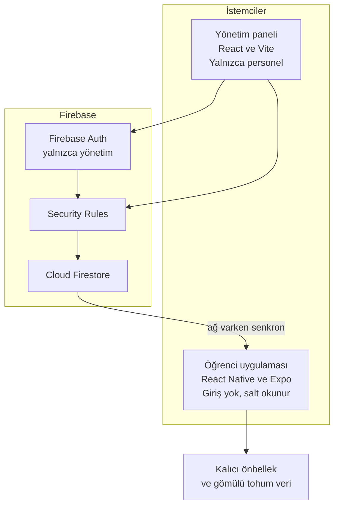

# Nallıhan MYO Mobil Uygulaması ve Yönetim Sistemi

Ankara Üniversitesi Nallıhan Meslek Yüksekokulu için hazırlanan girişsiz öğrenci ve aday öğrenci rehberi ile bu rehberi besleyen web yönetim paneli.

| | |
| --- | --- |
| Kurum | Ankara Üniversitesi Nallıhan Meslek Yüksekokulu |
| Tür | Akademik ve kurumsal ürün: mobil rehber + yönetim paneli |
| Çalışma biçimi | Monorepo (`/mobile`, `/admin`, `/docs`) |
| Durum | Faz 0 — depo iskeleti. Uygulama paketleri henüz kurulmamıştır |
| v1 sözü | Hesap açmadan kullanılabilen, çevrimdışı çalışan kurumsal rehber |
| v1.1 / Faz 2 | Anılar modülü; ancak kapı şartları tamamlanırsa |

Bu depo, sınıf ve jüri incelemesi için okunacak kaynaktır. Kod yazılmadan önce alınan kapsam, mimari ve devir kararları buradadır. Veri alanlarının taslağı [`docs/BILGI.md`](docs/BILGI.md) içindedir.

**Önerilen okuma sırası:** vizyon, mimari, ekranlar, Anılar kararının gerekçesi, klasörler, kurulum, devir.

---

## Proje vizyonu ve amacı

Nallıhan'daki kampüs, Ankara kent merkezine uzak bir ilçe kampüsüdür. Öğrenci ve aday öğrenci; programı, dersliğin hangi katta olduğunu, yurdun adresini, ilçedeki işe yarar noktaları ve kimin aranacağını çoğu zaman yolculukta, yurtta veya zayıf çekimde öğrenmek zorundadır. Bu bilgi bugün duyuru, ağızdan tarife ve dağınık bağlantılar arasında kalır.

Ürünün işi bu dağınıklığı tek bir rehberde toplamaktır.

Rehber iki kişi için tasarlanır ve ikisi de hesap açmaz:

- **Kayıtlı öğrenci**, okulun birimlerini, mekânları, yurtları, ilçeyi ve acil numaraları açar.
- **Aday öğrenci**, henüz okul kimliği yokken programları, kayıt notunu, yol tarifini ve kampüsü tanır.

Girişsizlik bir eksiklik değildir. v1'in ürün sınırıdır.

- Aday öğrencinin okul hesabı yoktur. Rehber, kayıt olmadan ilk günden işe yarar.
- Uygulama ad, numara, parola veya profil toplamaz. Kişisel veri yüzeyi, kurumun zaten kamuya anlattığı bilgiyle sınırlı kalır.
- Parola sıfırlama, hesap birleştirme ve oturum desteği diye bir işletme yükü okula devredilmez.
- Mağaza incelemesi "kurumsal bilgi uygulaması" kapsamında yürür. Kullanıcı içeriği incelemesi v1'e girmez.

Personel ayrı bir kapıdan girer. Web yönetim paneli Firebase Authentication ister. Öğrenci uygulaması ile panel aynı veriyi paylaşır; yazma yetkisi yalnızca paneldeki görevlidedir. Yeni duyuru, yeni derslik veya değişen servis saati için uygulama mağazasına sürüm çıkılmaz. Görevli belgeyi yayınlar, öğrencinin cihazı ağa çıktığında güncellenir.

İçerik, idarenin doğruladığı metinlerden oluşur. Kaynak, panelden yazılan belgedir. "X Nerede?" bina, kat ve mekân rehberidir; konum izni istemez.

---

## Sistem mimarisi

Üç parça vardır. Öğrenci telefonunda Expo uygulaması, personelin tarayıcısında Vite paneli, ortada Cloud Firestore.



Okuma herkese açıktır. Yazma, `admin` özel hakkı (Firebase custom claim) taşıyan oturuma bağlıdır. Öğrenci uygulamasında Firebase Auth yoktur.

### Neden React Native ve Expo

Okulun sürdürebildiği ürün, tek kod tabanından hem iOS hem Android'e çıkan üründür. Ayrı bir Swift ekibi ile ayrı bir Kotlin ekibi, mezuniyetten sonra devredilecek bir meslek yüksekokulu projesinde işletme modeline uymaz.

Expo'nun yönetilen iş akışı bu kısıta uyar:

- Derslik ve jüri, geliştirme sırasında Expo Go ile aynı kodu telefonda açabilir. Xcode veya Android Studio kurmak, demoyu izlemenin ön şartı olmaktan çıkar.
- Ekranlar JavaScript ve TypeScript ile yazılır. Panel de aynı dil ailesindedir. Devir alan kişi iki platform dili öğrenmez.
- `android/` ve `ios/` klasörleri kaynak diye elle taşınmaz. `npx expo prebuild` gerektiğinde üretir. Kök `.gitignore` bu üretilmiş klasörleri dışarıda tutar ve gerekçesini satır satır yazar.
- Uygulama kabuğundaki küçük düzeltmeler, mağaza incelemesini beklemeden EAS Update ile iletilebilir. İzin, SDK ve şema değişiklikleri ise normal mağaza sürümüdür. İçerik ikisinin de dışındadır; içerik Firestore belgesidir.

### Neden React ve Vite ile ayrı bir panel

Rehberin asıl bakım işi kod değil, içeriktir. Personelin telefon uygulamasının içine gömülü bir "gizli yönetici modu" bu işi görmez. Ortak cihaz, yanlışlıkla açık kalan oturum ve mağaza derlemesine karışmış yazma kodu devirde sorun çıkarır.

Panel bu yüzden ayrı bir web uygulamasıdır:

- Personel bilgisayar ve tarayıcı kullanır. Form, uzun metin ve yayın kontrolü bu yüzeyde rahattır.
- Vite, geliştirmede hızlı açılır ve üretimde statik dosya basar. Statik panel Firebase Hosting'e ya da okulun seçeceği barındırmaya konabilir. Ayrı bir Node sunucusu bakılmaz.
- Paneldeki her ekran bir Firestore koleksiyonuna karşılık gelir. Yeni bir öğrenci geliştirici, "hangi form hangi belgeyi yazıyor?" sorusunu koleksiyon adından yanıtlar. Eşleme [`docs/BILGI.md`](docs/BILGI.md) taslağındadır.
- Öğrenci derlemesinde yazma kodu bulunmaz. Yazma yüzeyi panelde, yetki ise güvenlik kurallarındadır.

### Neden Cloud Firestore

Mezuniyetten sonra okulun ayakta tutacağı şey, kendi veri merkezinde yamalanacak bir API değildir. Firestore bu proje için şu işleri birlikte görür:

- Belge modeli rehbere uyar. Mekân, yurt, hat ve duyuru zaten karttır. Kart, belge olarak durur.
- Güvenlik kuralları sunucu tarafındadır. İstemciye gömülü Firebase yapılandırması bir sır değildir; proje kimliğidir. Asıl sınır, "herkes okur, yalnızca personel yazar" kuralıdır. Bu ayrım derste özellikle anlatılır, çünkü anahtarın GitHub'da görünmesi ile servis hesabı özel anahtarının sızması aynı şey değildir. Özel anahtar `.gitignore` ile dışarıdadır.
- Mobil SDK'nın kalıcı önbelleği, çevrimdışı rehberin temelidir.
- Spark kotası, kampüs rehberi ölçeğinde anlamlı bir başlangıçtır. Ücretli plana geçiş öğrencinin kartıyla değil, kurumun fatura hesabıyla yapılır. Eşik devir planındadır.
- Panelin statik dosyaları aynı proje içinden barındırılabilir. Operasyon tek konsolda toplanır.

Kimlik doğrulama yalnızca panelde, Firebase Authentication ile kullanılır. Personel hesabına `admin` özel hakkı verilir. Hakkı olmayan oturum belge yazamaz. Öğrenci uygulaması bu kapıya hiç gelmez.

### Çevrimdışı öncelik

İlçe kampüsünde ağ, ürünün varsayılanı sayılmaz. Ağ, taze verinin geldiği andır. Uygulama üç katmanla açılır:

1. **Tohum veri.** Kurum kimliği ve `sabit` işaretli acil numaralar uygulama paketinin içindedir. İlk kurulumda Firestore'a hiç ulaşılamazsa ekran boş kalmaz. 112 ve idarenin zorunlu saydığı numaralar aranabilir.
2. **Kalıcı önbellek.** Son başarılı senkron, cihazda Firestore önbelleği olarak durur. Uçak modu, yolculuk ve zayıf çekim bu kopyayı okur.
3. **Sessiz yenileme.** Ağ geldiğinde önbellek arka planda tazelenir. Öğrenci "yükleniyor" duvarının arkasında beklemez. Bir belge henüz inmediyse uygulama eldeki kopyayı gösterir ve taze olduğunu iddia etmez.

Arama da bu modele uyar. Rehberin veri hacmi bir kampüs kadardır. Ayrı bir arama hizmeti ikinci satıcı, ikinci anahtar ve çevrimdışı boşluk getirir. Uygulama, her belgenin `aramaAnahtarlari` dizisini cihazdaki kopyanın içinde tarar. Normalizasyon Türkçe yerelle yapılır. `I/ı` ve `İ/i` ayrımı testle korunur.

Panel çevrimdışı çalışmak zorunda değildir. İçerik ofiste, ağ varken yazılır. Çevrimdışı sözü öğrenci uygulamasınadır.

### Güncellemenin üç kanalı

| Kanal | Ne değişir | Mağaza incelemesi |
| --- | --- | --- |
| Firestore | Duyuru, mekân, saat, numara, program notu | Gerekmez |
| EAS Update | Uygulama kabuğundaki JavaScript düzeltmesi | Gerekmez |
| Mağaza sürümü | İzin, SDK, yerleşik tohum verinin değişmesi | Gerekir |

Personel çoğu işi birinci kanaldan görür. Bu, mezun olan ekibin her metin düzeltmesinde Xcode açmaması için bilinçli bir seçimdir.

---

## Uygulama ekranları ve modüller

v1 dört modül ve iki global davranıştır. Dördü de salt okunurdur. İçerikleri panelden gelir.

### 1. Üniversitemiz, "X Nerede?" ve aday öğrenci

Bu modül kampüsün kendisidir.

**Üniversitemiz** okulun kısa tanımını, adresini, santralini, resmî sitesini ve harita bağlantısını gösterir. Metin `kurum/genel` belgesindedir. Uygulama içine gömülü bir tarihçe paragrafı yoktur; idare metni panelden değiştirir.

**"X Nerede?"** derslik, laboratuvar, öğrenci işleri veya kantin sorusunu bina, kat ve mekân adına bağlar. Kartta kısa yön tarifi ve varsa çalışma saati durur. Çalışma saati serbest metindir. Canlı doluluk veya kapı sensörü yoktur.

Bilinçli olarak olmayanlar: GPS izni, bina içi konumlandırma, mavi nokta, adım adım navigasyon. Bunlar pahalı donanım, kırılgan kalibrasyon ve mağazada konum beyanı ister. Kat rehberi bu yükü almadan soruyu yanıtlar. Arama kutusuna "laboratuvar" yazmak, ilgili kat kartını açar.

**Aday öğrenci** aynı uygulamanın içinde ayrı bir kapıdır. Ayrı bir APK yoktur. Program kartı, kayda ilişkin idare notu, kampüse nasıl gelineceği ve sık sorulan sorular bu kapıdadır. Kontenjan ve tarih uydurulmaz. Alan boşsa kart, idare yazana kadar yayınlanmaz (`yayinda: false`).

### 2. Yurtlarımız

Yurt kartı ad, tür, adres, telefon, başvuru bağlantısı ve yol tarifinden oluşur. Tür alanı `kyk`, `okul`, `ozel` veya `diger` değerlerini alır. Böylece KYK yurdu ile özel yurt aynı ekranda, aynı şemayla durur ve idare hangilerinin öğrenciye önerileceğine panelden karar verir.

Başvuru, uygulamanın içinde bir form değildir. Resmî başvuru adresi bağlantı olarak verilir. Uygulama yurt adına kimlik fotokopisi veya öğrenci belgesi toplamaz. Bu sınır, girişsizlik kararıyla aynı yerde durur: v1 bir başvuru sistemi değildir, başvuru kapısının tarifidir.

### 3. Şehrimiz ve ulaşım

İki alt başlık vardır.

**Şehrimiz**, ilçede işe yarayan noktaların kartlarıdır. Sağlık, market, kamu ve benzeri kategoriler `yerler` koleksiyonundadır. Kartın telefonu varsa tek dokunuşla aranır. Listenin uzunluğunu idare belirler: öğrencinin işine yarayan kartlar yayınlanır.

**Ulaşım**, Ankara–Nallıhan bağlantısı, varsa servis ve yürüyüş tarifesi gibi güzergâhların editoryal anlatımıdır. Duraklar sıralı listedir. Saat ve ücret notu metindir.

Canlı belediye veya otobüs API'si v1'e alınmamıştır. Dış API anahtar ister, sözleşmesi değişir, kota biter ve çevrimdışı modele uymaz. Saat değişince personel `saatNotu` alanını günceller. Bu, devir sonrasında da açıklanabilir bir işletme modelidir.

### 4. Ayarlar ve erişilebilirlik

Ayarlar bir hesap ekranı değildir. Cihazda durur. Firestore'a kullanıcı tercihi yazılmaz, çünkü yazılacak bir kullanıcı kimliği yoktur.

v1 ayarları:

- **Yazı ölçeği.** Sistem boyutuna uyar ve uygulama içinden büyütülebilir. Ölçek, sabit piksel yüksekliğine kilitlenmiş kartları kırmaz.
- **Yüksek kontrast.** Metin ve zemin belirteçleri kontrastlı palete geçer.
- **Azaltılmış hareket.** Sistem tercihine uyulur; geçişler kısalır.
- **Hakkında.** Sürüm, verinin okul idaresinden geldiği, uygulamanın hesap toplamadığı ve kurumsal iletişim bilgisi.

Dokunma hedefleri en az 44 punto planlanır. Ekran okuyucu etiketleri ikonun yanında, metin olarak da bulunur. Renk tek başına anlam taşımaz. Acil numara kırmızı olduğu için değil, "Ara" eylemi ve numarası yazdığı için anlaşılır.

Bu modül aynı zamanda gizlilik metninin durduğu yerdir. Metin, hesap toplanmadığını ve içerik işletiminin Firebase altyapısında yürüdüğünü sade dille söyler. Ayrı bir analitik SDK'sı v1 kapsamına alınmamıştır.

### Global arama

Arama, modüllerin üstündedir. Tek kutu; program, mekân, yurt, şehir kartı, ulaşım ve duyuru başlıklarında çalışır. Dizin cihazdaki belgelerdir. Ağ yokken son önbellek aranır. Sonuç, kendi modülünün kartına gider.

Arama bir sohbet veya yapay zekâ kutusu değildir. Eşleşme, idarenin yazdığı anahtar kelimeler ve başlıklar üzerindendir. Böylece rehber, kaynakta olmayan bir oda veya saat uydurmaz.

### Acil numaralar

Acil numaralar hem kendi listesinde hem de uygulamanın her an ulaşılan kısayolundadır. Kısayol bir jestin arkasına gizlenmez.

- `sabit` kayıtlar tohum veridedir. Önbellek hiç dolmamış olsa da 112 aranabilir.
- Kampüs güvenliği, yurt nöbeti ve idarenin eklediği numaralar Firestore'dan gelir ve önbelleğe yazılır.
- Satır, `tel:` bağlantısı açar. Uygulama aramayı kendi içinde kurmaz, işletim sisteminin arama ekranına bırakır.
- Numara silinmek istendiğinde `sabit` kayıt panelde uyarı verir. 112'nin listeden kaybolması bir içerik hatası sayılır.

---

## Anılar modülü neden v1.1'e bırakıldı

Anılar, kampüste çekilmiş fotoğraf ve anı metninin öğrenciler tarafından paylaşıldığı bir modül olarak düşünüldü. İstek anlaşılırdır. Jüriye de anlatılacak karar, bu modülün v1'den çıkarılmasıdır. Gerekçe takvim sıkışması değildir. Üç ayrı rejimin aynı anda doğurduğu işletme ve inceleme yüküdür: 6698 sayılı Kişisel Verilerin Korunması Kanunu, Apple App Store Review Guideline 1.2 ve Google Play kullanıcı içeriği politikası.

v1 kod tabanında anı yazma, fotoğraf yükleme, herkese açık profil ve şikâyet kuyruğu bulunmayacaktır. Modül bir özellik bayrağının arkasına saklanmayacaktır. Kapalı bir kullanıcı içeriği yolu da incelemede ve kişisel veri değerlendirmesinde soru doğurur. v1'de bu yolun kodu yoktur.

Bu bölüm hukuk danışmanlığı değildir. Kanunun kurumda nasıl işletileceğini üniversitenin hukuk ve KVKK birimi söyler. Burada kaydedilen, o onay ve mağaza şartları tamamlanmadan modülün yazılmayacağı mühendislik kararıdır.

### KVKK

Anı fotoğrafı ve yanında duran ad, kimliği belirli veya belirlenebilir bir kişiye ilişkinse kişisel veridir. Grup fotoğrafında kadraja giren herkes paylaşımın tarafı olmayabilir. Kare, sağlık hali veya inanç gibi özel nitelikli veriyi de istemeden taşıyabilir. Bu olasılık, "öğrenci kendi fotoğrafını yükledi" cümlesini yeterli bir hukuki gerekçe yapmaz.

Veriyi işlemek aydınlatma yükümlülüğü, işleme şartı, ilgili kişinin erişim ve silme hakları ile uygun güvenlik tedbirini gerektirir. Veri sorumlusu sıfatı, projeyi yazan öğrencinin kişisel Google hesabına yazılamaz. Sorumlu, üniversite tüzel kişiliğidir. Saklama süresi, imha ve başvuru yanıtı bir ekran değil, idari süreçtir. Bu süreç idarede isimlendirilmeden fotoğraf toplanması, jüri demosu için dahi kabul edilmez.

Girişsiz v1 bu yüzden kişisel veri toplamayan bir rehber olarak sadeleşir. Anılar, hesap ve rıza olmadan bu sadeleşmeye uymaz. Modül ancak veri sorumlusu adına işletilen ayrı bir faz olarak geri gelir.

### Apple Guideline 1.2

App Store Review Guideline 1.2, kullanıcı tarafından üretilen içeriği olan uygulamalardan dört yeteneği birlikte bekler: sakıncalı içeriğin yayımlanmadan filtrelenmesi, şikâyet mekanizması ve şikâyete zamanında yanıt, rahatsız eden kullanıcının engellenmesi, kullanıcının geliştiriciye ulaşacağı yayımlanmış bir iletişim yolu.

Bunlar bir ayar ekranına eklenen dört düğme değildir. Filtre bir ölçüttür. Şikâyet, bakacak personeli olan bir kuyruktur. Engelleme, kimliği olan kullanıcılar arasında anlamlıdır. İletişim yolu, mezun olduktan sonra da yanıtlanan bir kurumsal adrestir. Öğrenci geliştiricinin kişisel postası bu adres olamaz.

Ayrıca meslek yüksekokulu öğrencileri arasında 18 yaşından küçük kullanıcı olabilir. Anılar açıldığında yaş derecelendirme formu ve moderasyon soruları yeniden yanıtlanır. v1 derecelendirmesi, kullanıcı içeriği olmayan bir bilgi uygulaması olarak hazırlanır.

### Google Play moderasyonu

Google Play'in kullanıcı içeriği politikası da aynı işletme gerçekliğini ister. Kullanıcı, içerik üretmeden önce kullanım şartlarını kabul eder. Sakıncalı içerik tanınır ve yasaklanır. Uygulama içinden şikâyet edilir. Uygun görülen içerik veya kullanıcıya karşı işlem yapılır.

Fotoğraf izni (`READ_MEDIA_IMAGES` ve karşılığı beyanlar) inceleme sorusu ekler. Moderasyonsuz herkese açık duvar, yayından sonra da kaldırılma riski taşır. Okulun mağaza hesabından kaldırılan bir uygulama, rehberin asıl işini de keser. Risk, anı özelliğinin kendisinden büyüktür: kaldırma kararı kat rehberini ve acil numarayı da erişilemez kılar.

### Faz 2 kapı şartları

Aşağıdaki şartların tamamı oluşmadan Anılar koduna başlanmaz.

1. Üniversite veya MYO, veri sorumlusu sıfatıyla modülü onaylar. Aydınlatma metni ve işleme şartı yazılır.
2. Açık rıza kaydı ve silme talebi, yanıtlayacak birimle birlikte tanımlanır. Grup fotoğrafındaki üçüncü kişiler için kural netleşir.
3. Mağazanın istediği üçlü kurulur: filtre, şikâyet, engelleme. Şikâyete bakacak personel isim ve yedekle yazılıdır.
4. Yönetim panelinde moderasyon kuyruğu vardır. Onaysız anı herkese açık listeye düşmez.
5. Fotoğraf için saklama süresi ve imha adımı yazılıdır.
6. Uygulama, okulun kurumsal Apple ve Google geliştirici hesaplarından yayınlanır. Öğrenci hesabı yayıncı değildir.
7. Yaş ve içerik formları, kullanıcı içeriği varmış gibi yeniden doldurulur.

Şartlar tamamlandığında modül v1.1 olarak, kendi koleksiyonu ve kendi panel ekranlarıyla eklenir. v1 şemasında `anilar` koleksiyonu bilinçli olarak yoktur.

---

## Klasör yapısı

Depo bir monorepodur. İki uygulama ve belgeler aynı kökte, aynı geçmişte durur. Ortak bir paket yöneticisi zorlaması Faz 0'da yoktur. `/mobile` ve `/admin` kendi `package.json` dosyalarına sahip olacaktır. Paylaşılacak şey kod paketi değil, veri sözleşmesidir. Sözleşme `/docs` altındadır.

```
nallihan-myo-mobil-rehber/
├── mobile/                 Öğrenci uygulaması (Expo, Faz 1'de kurulacak)
│   └── BILGI.md            Klasör sınırı ve kurulum notu
├── admin/                  Personel paneli (React + Vite, Faz 1'de kurulacak)
│   └── BILGI.md
├── docs/                   Şema, kural gerekçesi, sunum ve devir notları
│   └── BILGI.md            v1 koleksiyon taslağı
├── .gitignore              Üretilen dosya, sır ve işletim sistemi kalıntısı
└── README.md               Bu belge
```

`BILGI.md` dosyaları iki iş görür. Git boş klasörü takip etmez; bu dosyalar klasörü kayıt altına alır. Ayrıca klasöre giren kişi, o klasörün neyi barındıracağını ve neyi barındırmayacağını okur.

Kökte bir `package.json` yoktur. Bilinçli bir seçimdir. Öğrenci uygulaması ile panelin bağımlılıkları birbirine karışmasın, birinin sürüm yükseltmesi diğerini kırmasın diye kurulumlar ayrı dizinlerde yürür. İleride ortak tür paketi açılırsa bu karar yeniden yazılır. Açılana kadar paylaşılan sözleşme Markdown'daki şemadır.

---

## Kurulum ve çalıştırma

### Şu anki durum

Faz 0 iskeletidir. `mobile/` ve `admin/` altında `package.json` yoktur. Aşağıdaki komutlar bir sonraki geliştirme adımının tarifidir. Bu haliyle `npm start` çalıştırılmaz, çünkü başlatılacak bir paket yoktur.

### Ortak önkoşullar

- Node.js 22 veya daha yeni bir LTS sürümü ve buna gelen npm
- Git
- Yönetim paneli ve mobil veri katmanı için bir Firebase projesi (kurumsal hesapta açılması devir planının parçasıdır)
- Telefonda deneme için Expo Go, ya da aynı ağdaki bir emülatör

Sürüm pinleri, iskelet kurulunca ilgili `package.json` dosyasına yazılır. Bu README bir SDK numarasını ezberden kilitlemez.

### Mobil uygulamanın kurulumu

Expo, dolu klasöre iskelet basmaz. `BILGI.md` kurulum anında kenara alınır.

```bash
cd mobile
mv BILGI.md "$TMPDIR/nallihan-mobile-BILGI.md"
npx create-expo-app@latest . --template blank-typescript
mv "$TMPDIR/nallihan-mobile-BILGI.md" ./BILGI.md
npm install
npx expo start
```

Terminaldeki karekod Expo Go ile okunur. Geliştirme bilgisayarı ile telefon aynı ağdadır. Jüri demosu bu yolla, mağaza hesabı beklemeden yapılır.

Üretim derlemesi ve mağaza yüklemesi EAS üzerinden, kurumsal geliştirici hesaplarıyla yapılır. Keystore ve Apple sertifikası depoya girmez. `.gitignore` içindeki imza bölümü bu yüzden yazılmıştır.

### Yönetim panelinin kurulumu

```bash
cd admin
mv BILGI.md "$TMPDIR/nallihan-admin-BILGI.md"
npm create vite@latest . -- --template react-ts
mv "$TMPDIR/nallihan-admin-BILGI.md" ./BILGI.md
npm install
npm run dev
```

Geliştirme adresi Vite'ın yazdığı yerel adrestir (şablonun varsayılanı `http://localhost:5173`). Üretim derlemesi `npm run build` ile `admin/dist` altına basılır. Bu klasör Git'e girmez. Yayın, derlemenin barındırmaya yüklenmesiyle olur.

### Ortam değişkenleri

Her uygulama dizininde gerçek değerler `.env` içine yazılır. Depoya yalnızca `.env.example` girer. Şablon, değişkenin adını ve birimini gösterir, değeri göstermez.

İstemci yapılandırmasındaki Firebase apiKey, Security Rules ile birlikte çalışan bir proje kimliğidir. Servis hesabı JSON dosyası ise tam yetkili özel anahtardır ve hiçbir örnek şablona konmaz. İkisi arasındaki fark, mimari bölümünde ve `.gitignore` yorumlarında kasıtlı olarak tekrar edilir.

### Çalıştığını anlamak

Faz 1 iskeleti kurulduğunda beklenti şudur:

- Expo, geliştirme sunucusunu açar ve boş uygulama telefonda veya emülatörde görünür.
- Vite paneli yerel adreste açılır.
- Firebase bağlanınca panelden yayınlanan bir mekân, öğrenci uygulamasında önbelleğe düşer.
- Cihaz uçak moduna alınınca son mekân kartı ve tohumdaki acil numara ekranda kalır.

Bu dört gözlem, jüri demosunun kabul listesidir.

---

## Sürdürülebilirlik ve devir planı

Proje, mezun olan öğrencilerin kişisel hesaplarında yaşasın diye tasarlanmaz. Yaşayan parçalar kurumun hesabına, personelin yetkisine ve depodaki tarife devredilir. Devir, teslim günü akşamı paylaşılan bir klasör değil, aşağıdaki sırayla yürüyen bir mimaridir.

### 1. Hesap sahipliği kod yazılmadan kurulur

Firebase projesi, mümkünse ilk günden okulun kurumsal Google hesabında açılır. Geliştirici o projeye davet edilir. Proje öğrencinin kişisel Gmail'inde açıldıysa, mezuniyetten önce kurumsal hesaba devredilir ve kişisel hesap sahip rolünden çıkar.

Apple Developer ve Google Play kayıtları da kurumsal yayıncı hesabıdır. Uygulama adı, paket kimliği ve imza anahtarı bu hesaplara bağlıdır. Öğrenci geliştiricinin bireysel mağaza üyeliği yayın kanalı olarak kullanılmaz. Aksi halde mezuniyet, uygulamanın güncellenememesi demektir.

Git deposunun sahibi, danışmanın veya okulun organizasyonudur. Öğrenci yazma hakkıyla katkı verir. Devir kapanınca sahip hakkı kurumda kalır.

### 2. İçerik ile kod birbirinden ayrılır

Personel, duyuru ve kat rehberi için pull request açmaz. Panelden belge yayınlar. Kod deposu uygulama kabuğunu taşır. Bu ayrım bozulursa her metin düzeltmesi bir geliştirici bekler ve ürün bir öğretim yılı içinde eskir.

Devir paketinin içindeki işletme notu şunları söyler: hangi koleksiyon hangi ekrana bağlı, taslak ile yayının farkı ne, `sabit` acil numara neden silinmiyor, saat notu hangi metinle güncelleniyor.

### 3. Sırlar şifre yöneticisinde teslim edilir

Depo geçmişi sır taşımaz. Teslim edilenler şunlardır:

- Firebase proje sahipliği ve faturalandırma hesabı
- `admin` özel hakkını verebilen yetkili kullanıcı
- Apple ve Google imza malzemesi
- Barındırma yayın yetkisi
- `.env` değerlerinin kuruma ait kopyası

Servis hesabı anahtarı sohbet uygulamasında gönderilmez. Kurumun şifre yöneticisine yazılır. Devir sonunda öğrencide kalan kopyalar silinir ve anahtarlar yenilenir. Yenileme, güven ilişkisinin bittiği anlamına gelmez. Ayrılan kişide yetki kalmaması anlamına gelir.

### 4. Uygulama, hesap kapansa da rehber olmaya devam eder

Tohum veri, acil numarayı ve kurum kimliğini paketin içinde tutar. Firestore kotası, fatura veya proje erişimi kesilirse öğrenci son önbelleğini ve tohum veriyi görmeye devam eder. Taze duyuru durur. Arama ve 112 durmaz. Bu bozulma biçimi bilinçlidir: bilgi eksilir, güvenlik numarası eksilmez.

### 5. Maliyet eşiği yazılıdır

Spark kotası geliştirme ve sakin dönem için başlangıçtır. Kayıt haftası gibi okuma sıçramalarında kalıcı önbellek, her açılışın ağa gitmesini engelleyerek kotayı korur. Ücretli plana geçiş şu şartla açılır: fatura kurumsal ödeme yöntemine bağlıdır, bütçe uyarısı tanımlıdır, kart bilgisi öğrencide değildir. Eşik aşılırsa danışman ve idare birlikte karar verir.

### 6. Öğretim yılı ritmi

İdare içinden bir personel içerik sorumlusudur. Yedek bir personel aynı `admin` hakkına sahiptir. Tek kişiye bağlı devir kabul edilmez. İstenirse bir sonraki öğretim yılının öğrencisi, kod hatası için depoya katkı verir. Katkı, sahip rolü değildir.

Yıl içinde en az bir kez şunlar gözden geçirilir: program notları, yurt kartları, ulaşım saat notu, acil numara listesi, panelden ayrılan personelin hesabının kapatılması.

### 7. Devir kapanışı

Kapanış kontrolü:

- Kurumsal hesaplar sahip, öğrenci hesapları konuk bile değil
- Mağaza iletişim adresi kurumsal ve yanıtlanıyor
- `admin` hakkı yalnızca görevli personelde
- Şifre yöneticisindeki sır listesi ile çalışan ortam birebir
- `.env.example` güncel, gerçek `.env` depoda yok
- `docs/` altındaki şema, yayındaki koleksiyonlarla aynı
- Tohum verideki sabit numaralar son kez denenmiş
- Bu README'deki üç güncelleme kanalı, içeriği devralan kişiye anlatılmış

Anılar ancak devir planındaki hesap sahipliği oturduktan ve Faz 2 kapı şartları tamamlandıktan sonra aynı kapanış listesine eklenir. Modül, kişisel hesap üzerinde "geçici" diye açılmaz.

---

## Belge haritası

| Belge | İş |
| --- | --- |
| `README.md` | Vizyon, mimari, kapsam, kurulum ve devir |
| `.gitignore` | Neyin depoya girmeyeceği ve bunun derslik gerekçesi |
| `mobile/BILGI.md` | Öğrenci uygulamasının sınırı |
| `admin/BILGI.md` | Panelin sınırı |
| `docs/BILGI.md` | v1 koleksiyon taslağı ve güvenlik kuralının ilkesi |

Kod başladığında şema bu tablodaki taslaktan çıkıp `firestore.rules` ile birlikte güncellenir. README'deki kapsam kararı ile çelişen bir kolaylık, önce bu belgede gerekçesiyle değiştirilir, sonra koda girer.
